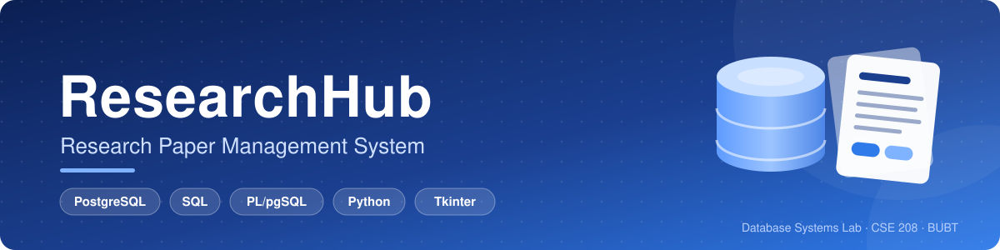
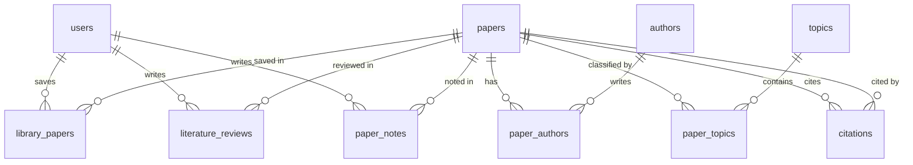

<div align="center">



A relational database project for storing, organizing, searching and managing academic research papers, with a simple desktop interface.


**Course:** Database Systems Lab (CSE 208) · Bangladesh University of Business & Technology (BUBT)

</div>

---

## 📖 About

ResearchHub keeps everything about research papers in one structured place: papers, authors, topics, personal reading libraries, literature reviews, citations and notes. The focus of the project is **relational database design and SQL implementation**; the desktop app is a small front end that shows the database at work.

## ✨ Key Features

| Feature | What it does |
|---|---|
| 👤 User Management | Users with roles: student, researcher or faculty |
| 📄 Paper Management | Add, edit, delete and search papers |
| ✍️ Author Management | Authors linked to papers in order |
| 🏷️ Topic Management | Classify papers under one or more topics |
| 📚 Personal Library | Save papers and track status: to read, reading, completed |
| 🔗 Citation Management | Record which paper cites which; a paper cannot cite a later-published paper |
| 📝 Literature Reviews | Short review and a 1 to 5 rating per paper |
| 🗒️ Personal Notes | Private notes per paper with an automatic "updated at" time |
| 📊 Reports | Ready-made reports using GROUP BY, HAVING, joins and subqueries |

## 🛠️ Tech Stack

| Tool | Use |
|---|---|
| **PostgreSQL** | Relational database |
| **pgAdmin 4** | Database administration, SQL execution, ER diagram |
| **SQL and PL/pgSQL** | Tables, queries, views, indexes, functions, procedure, triggers |
| **Python, Tkinter, psycopg2** | Desktop interface connected to the database |

## 🗄️ Database Design

The database has **10 tables**. Many-to-many relationships are resolved with junction tables, and the design follows third normal form (3NF).

| Table | Purpose |
|---|---|
| `users` | Registered users |
| `papers` | Research paper details |
| `authors` | Author information |
| `paper_authors` | Papers ↔ authors (many-to-many), with author order |
| `topics` | Research topics |
| `paper_topics` | Papers ↔ topics (many-to-many) |
| `library_papers` | Papers saved by each user, with reading status |
| `literature_reviews` | A user's review and rating of a paper |
| `citations` | Which paper cites which paper (self-referencing) |
| `paper_notes` | A user's personal notes on a paper |



**Database objects:** 4 views, 8 indexes, 3 functions, 1 stored procedure and 2 triggers.

## 📂 Project Structure

```
Researchhub/
├── 01_schema.sql              # 10 tables, keys and constraints
├── 02_sample_data.sql         # sample data for every table
├── 03_views_indexes.sql       # views and indexes
├── 04_functions_triggers.sql  # functions, procedure, triggers
├── 05_queries_and_tests.sql   # demo queries and constraint tests
├── assets/
│   └── banner.svg             # README banner
├── .gitignore
├── README.md
└── app/                       # desktop application
    ├── researchhub_app.py
    ├── db.py
    ├── requirements.txt
    ├── .env.example
    └── README.md
```

## 🚀 Getting Started

### 1. Set up the database

1. Install PostgreSQL and pgAdmin 4.
2. In pgAdmin 4, create a database named `researchhub`.
3. Open the Query Tool on that database and run the files **in this order**:

   | Order | File |
   |---|---|
   | 1 | `01_schema.sql` |
   | 2 | `02_sample_data.sql` |
   | 3 | `03_views_indexes.sql` |
   | 4 | `04_functions_triggers.sql` |

4. `05_queries_and_tests.sql` is optional. It contains demo queries; run them one at a time.

### 2. Run the desktop app

Requires Python 3.8 or later. In a terminal:

```bash
git clone https://github.com/mdshihabhossain726/Researchhub.git
cd Researchhub/app
pip install -r requirements.txt
```

Create your own `.env` file from the example and put in your PostgreSQL password:

```bash
copy .env.example .env      # Windows
cp .env.example .env        # macOS / Linux
```

Then start the app:

```bash
python researchhub_app.py
```

> 🔒 The real `.env` file is listed in `.gitignore` and is never uploaded. Only `.env.example` (with a fake password) is shared. If `.env` is missing, the app shows a connection window instead.

More details are in [`app/README.md`](app/README.md).

## 🧠 SQL Concepts Demonstrated

| Concept | Where |
|---|---|
| Table creation, primary and foreign keys, UNIQUE, CHECK | `01_schema.sql` |
| INSERT, UPDATE, DELETE | `02_sample_data.sql`, `05_queries_and_tests.sql` |
| SELECT with WHERE and ORDER BY | `05_queries_and_tests.sql` |
| INNER JOIN and LEFT JOIN | `05_queries_and_tests.sql` |
| GROUP BY, HAVING and aggregate functions | `05_queries_and_tests.sql` |
| Subqueries | `05_queries_and_tests.sql` |
| Views and indexes | `03_views_indexes.sql` |
| Functions, procedure and triggers (PL/pgSQL) | `04_functions_triggers.sql` |

**Triggers:**
- `trg_paper_notes_updated_at` refreshes `updated_at` whenever a note is edited.
- `trg_citations_validate` rejects a citation to a paper published in a later year.

## ⚠️ Limitations

- A simple desktop interface, not a web application.
- Only paper details (title, abstract, year, authors, topics) are stored. PDF files are not uploaded or stored.
- Citations are entered manually; there is no external API integration.
- No recommendation, machine learning or advanced analytics features.

## 📝 Notes

- The sample papers and authors are real, well-known publications used only as illustrative data. Affiliations and citation links are simplified.
- User names and emails in the sample data are dummy values.

## 👨‍💻 Author

**Md. Shihab Hossain**
GitHub: [@mdshihabhossain726](https://github.com/mdshihabhossain726)

**Team (3 members):** Md. Shihab Hossain, Srabone Jahan Joita, Md. Solaiman Badsha
B.Sc. in CSE, Bangladesh University of Business & Technology (BUBT)

---

## 🤝 Connect With Me

<div align="center">

[](https://github.com/mdshihabhossain726)
[](mailto:mdshihabhossain726@gmail.com)
[](https://www.linkedin.com/in/mdshihabhossain726/)
[](https://mdshihabhossain726.github.io/)

<br>

Made as a Database Systems Lab project 🎓

</div>
